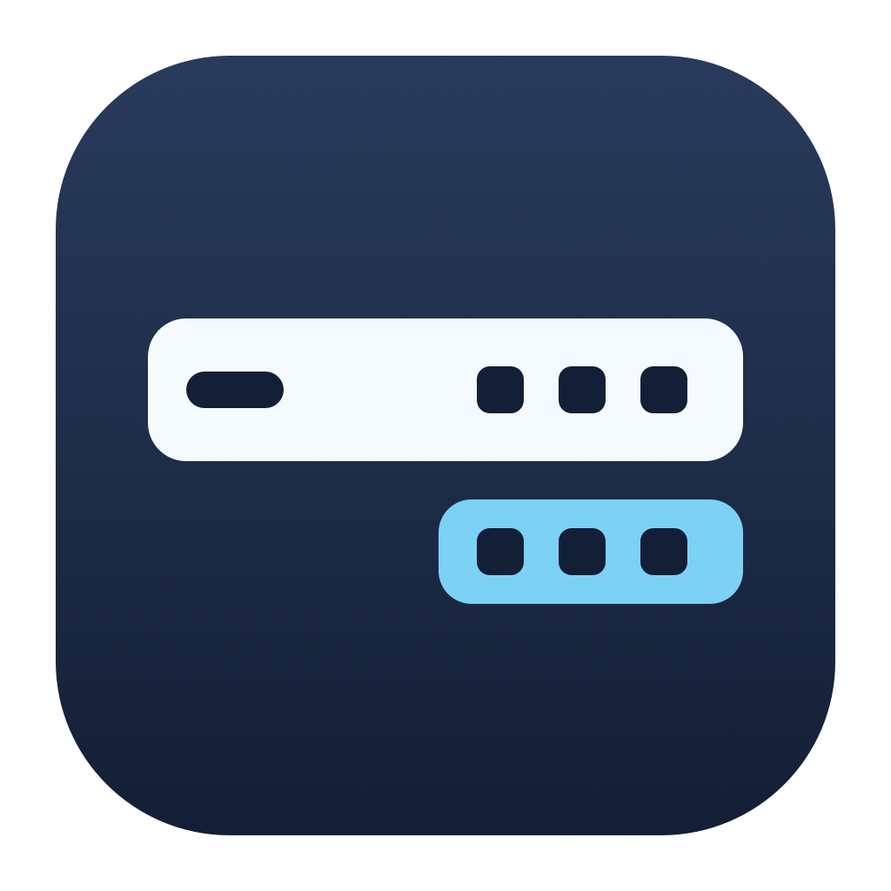

<p align="center">
  
</p>

<h1 align="center">Neat</h1>

<p align="center">
  <strong>필요한 아이콘만, 메뉴 막대에.</strong><br>
  자주 쓰는 아이콘은 남기고, 나머지는 필요할 때 꺼내 쓰세요.
</p>

<p align="center">
  
  
  <a href="upstream/LICENSE"></a>
</p>

<p align="center">
  <a href="#주요-기능">주요 기능</a> ·
  <a href="#설치">설치</a> ·
  <a href="#사용-방법">사용 방법</a> ·
  <a href="#개발-및-검증">개발 및 검증</a>
</p>

Neat은 macOS 27용 개인 메뉴 막대 정리 앱입니다. 설정창에서 아이콘을 **보임**과 **숨김**으로 나누고, 숨긴 아이콘은 별도 바에서 사용할 수 있습니다. [Thaw](https://github.com/thaw-app/Thaw)를 기반으로 합니다.

## 주요 기능

| 기능 | 동작 |
| --- | --- |
| **드래그로 정리** | 설정창에서 보임·숨김 영역으로 이동합니다. 분류와 순서는 저장되며, 새 아이콘은 보임 영역에 추가됩니다. |
| **클릭으로 펼치기** | Neat 아이콘이나 메뉴 막대의 빈 공간을 클릭하면 숨긴 아이콘이 나타납니다. |
| **원래 앱 메뉴 사용** | 펼쳐진 아이콘을 클릭하면 해당 앱의 메뉴가 열립니다. 바깥을 클릭하면 바가 닫힙니다. |
| **5초 뒤 자동 닫기** | 마지막 조작 이후 5초가 지나면 닫습니다. 포인터가 바 위에 있거나 앱 메뉴를 사용하는 동안에는 유지됩니다. 기본값은 꺼짐입니다. |
| **외부 모니터 지원** | 화면마다 별도 아이콘 바를 사용합니다. |
| **로그인 시 실행** | 첫 실행에서 켜며, 이후에는 사용자가 선택한 상태를 유지합니다. |

## 설치

소스에서 직접 빌드해 설치합니다. 아래 과정으로 만든 앱은 **로컬 실행용이며, 공증된 배포본은 아닙니다.**

### 지원 환경

| 항목 | 요구사항 |
| --- | --- |
| 운영체제 | macOS 27 이상 |
| 개발 도구 | 전체 Xcode 27 이상, Swift 6.4 이상 |
| 네트워크 | 최초 빌드 시 패키지와 지정 버전의 SwiftLint 다운로드에 필요 |

Xcode를 `/Applications/Xcode.app`에 설치하고 최초 실행 설정을 완료합니다. Command Line Tools만으로는 전체 앱을 빌드할 수 없습니다.

### 1. 빌드

프로젝트 루트에서 실행합니다.

```sh
# 최초 한 번: Neat 전용 로컬 서명 인증서 준비
./setup-signing.command

# 앱 빌드 및 서명
./build.command
```

완료되면 `build/Neat.app`이 생성됩니다. 빌드 로그는 `build/build.log`에서 확인할 수 있습니다. 이후 빌드에는 `./build.command`만 실행하면 됩니다.

<details>
<summary>로컬 서명과 빌드 도구 안내</summary>

서명 설정은 사용자 키체인에 인증서와 개인 키를 만들고, 코드 서명 용도로만 신뢰하도록 설정합니다. 기존 인증서가 있으면 재사용하며, macOS가 키체인 변경이나 서명 키 접근 승인을 요청할 수 있습니다. 개인 키는 저장소에 보관하지 않습니다.

빌드 스크립트는 지정 버전의 SwiftLint가 없으면 `.tools/bin/`에 설치하며, 서명 인증서가 없으면 빌드를 중단합니다.

</details>

### 2. 설치 및 권한 승인

1. Finder에서 `build/Neat.app`을 **응용 프로그램** 폴더로 복사합니다. macOS 27에서는 이 위치에 설치해야 자체 메뉴 막대 아이콘을 안정적으로 인식합니다.
2. 기존 Thaw가 실행 중이면 직접 종료한 뒤 Neat을 실행합니다. 두 앱이 동시에 메뉴 막대를 정리하지 않도록 합니다.
3. 첫 실행 안내에 따라 **손쉬운 사용**과 **화면 캡처** 권한을 허용합니다.
4. macOS 27에서 배치 파일 접근을 요청하면 안내된 파일을 선택합니다. 전체 디스크 접근 대신 선택한 파일의 접근 권한을 사용할 수 있습니다.
5. 화면 캡처 권한 변경 후 재시작 안내가 나타나면 Neat을 다시 실행합니다.

로그인 시 실행은 시스템 승인이 필요할 수 있습니다. 설정창에는 실제 시스템 상태가 표시됩니다.

## 사용 방법

1. **정리하기** — 설정창에서 아이콘을 **보임** 또는 **숨김** 영역으로 드래그합니다.
2. **펼치기** — Neat 아이콘이나 메뉴 막대의 빈 공간을 클릭합니다.
3. **사용하기** — 펼쳐진 바에서 아이콘을 클릭해 원래 앱 메뉴를 엽니다.
4. **닫기** — 바깥을 클릭합니다. 자동으로 닫으려면 설정의 **마지막 조작 이후 5초 뒤 자동으로 닫기**를 켭니다.

> macOS의 **메뉴 막대 자동 숨기기**가 켜져 있으면 시스템 설정에서 해당 옵션을 꺼야 아이콘을 정리할 수 있습니다.

## 업데이트 및 권한 복구

<details>
<summary>새 버전으로 업데이트하기</summary>

새 버전도 같은 인증서로 빌드한 뒤 `/Applications/Neat.app`에 교체 설치합니다. 인증서와 설치 경로를 유지해야 macOS가 기존 권한을 연결할 수 있습니다. 인증서를 삭제하거나 교체하면 권한을 다시 승인해야 할 수 있습니다.

</details>

<details>
<summary>권한을 허용했는데 미승인으로 표시될 때</summary>

이전에 임시 서명된 앱을 사용했다면 고정 서명으로 전환할 때 손쉬운 사용·화면 캡처 권한을 한 번 다시 승인해야 할 수 있습니다.

시스템 설정에서 이미 켜져 있는데도 Neat이 미승인으로 표시하면, 해당 권한 목록에서 기존 Neat 항목을 제거한 뒤 `/Applications/Neat.app`을 다시 추가합니다.

</details>

Neat의 번들 ID는 `local.hangjin.Neat`이며, 기존 Thaw의 설치나 설정을 덮어쓰지 않습니다.

## 개발 및 검증

```sh
./test.command
```

로컬 서명 빌드 흐름의 회귀 검사와 Neat 정책 테스트를 실행합니다. 기본값, 5초 유휴 판정, 조작 시 타이머 초기화, 로그인 최초 초기화 조건, 독립 프로필 경로를 검사합니다. 정책 테스트는 Command Line Tools 환경에서도 실행할 수 있습니다.

전체 앱의 네이티브 테스트에는 Xcode가 필요합니다. 실제 메뉴 막대나 권한에 영향을 주는 테스트는 실행 전에 내용을 확인하세요. 선택한 회귀 테스트의 재현 명령과 기존 검사 결과, 실기기 미검증 항목은 [검증 기록](docs/verification.md)에 정리되어 있습니다.

<details>
<summary>프로젝트 구조와 빌드 구성</summary>

```text
.
├── README.md                 # 프로젝트 소개 및 사용 안내
├── build.command             # Release 빌드 및 로컬 서명
├── setup-signing.command     # 고정 서명 인증서 준비
├── test.command              # 서명 회귀 검사 및 정책 테스트
├── Package.swift             # Neat 정책 테스트용 Swift 패키지
├── Tests/NeatPolicyTests/     # 정책 테스트
├── scripts/                  # 서명 회귀 검사 스크립트
├── docs/                     # 설계, 구현 계획, 검증 기록
└── upstream/                 # Thaw 기반 앱 소스 및 Xcode 프로젝트
    └── Thaw/Neat/            # Neat 기본 정책과 유휴 타이머
```

앱 빌드는 `upstream/Thaw.xcodeproj`의 `Thaw` 스킴을 사용하며, 결과 앱 이름은 `Neat.app`입니다. 루트의 Swift 패키지는 정책 테스트용입니다.

</details>

[구현 명세](docs/superpowers/specs/2026-10-19-neat-design.md) · [검증 기록](docs/verification.md)

## 원본 및 라이선스

Neat은 [Thaw](https://github.com/thaw-app/Thaw)의 `feat/thaw-3` 브랜치, 커밋 `c0afbdbf045eca8b1d276e7493272ee07c3996be`를 기반으로 합니다. 원본 코드와 Git 이력은 `upstream/`에 유지합니다.

[GPL-3.0 라이선스](upstream/LICENSE)를 따르며, 원본 저작권과 [크레딧](upstream/CREDITS.md), 종속 라이브러리 고지를 보존합니다. 앱 설정의 **오픈소스 고지**에서도 관련 내용을 확인할 수 있습니다.
