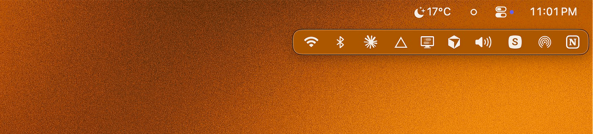

# Neat
나만 사용하려고 하는 맥북 전용 앱을 만드려고 해. 
앱 이름: Neat

## 무슨 앱인가? 

현재 내 맥북 앱을 보면, 디스플레이 메뉴막대에서 많은 앱들이 보여주고 있지만, 노치 부분으로 가려진 앱들이 보이질 않아.  
현재 내 맥버전에 맞는 메뉴바 정리앱을 만들고 싶어. 

보이는 앱과 숨긴 앱을 분류해서 , 메뉴 막대를 누르면 숨겨진 바가 생겨서 거기에 숨긴 앱들을 뜨게 하는거지 
당연히 앱 설정창에서는 앱들을 이동시켜서 분류할수도 있어.
참고 이미지: 

## 작동 방식
1. 설정창에서 보이는 앱과 숨긴 앱들을 분류한다. (참고: )
2. 메뉴바는 보이는 앱만 보이게 한다. 
3. 숨긴 앱을 보고 싶을시 메뉴바를 클릭하면 숨겨진 바가 생겨서 숨긴 앱들이 보임 (참고: )
4. 기본으로 다른 곳을 클릭시 숨겨진 바가 사라짐. 선택 사항으로 5초 후에 자동 사라지게끔 설정창에 기능 추가

참고 깃허브: https://github.com/thaw-app/Thaw